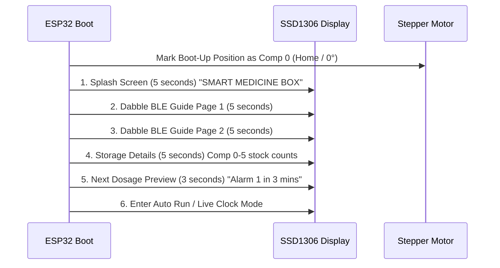

# Smart Medicine Box (SMB_V0.1)

Firmware for ESP32 DevKit V1 combining Dabble BLE interactive control, SSD1306 OLED display UI, A4988 Stepper motor control with 60° partitions, DS3231 RTC, and automated alarm workflows.

---

## 1. What's Changed in SMB_V0.1 (Homing Bug Resolution)

### The Issue in V0.0
* In `SMB_V0.0`, when Alarm 1 completed its 30-second wait at Compartment 1, instead of rotating in reverse back to **Home (Compartment 0 / boot position)**, the motor advanced forward into the next position (**Position A / Compartment 2**).
* Then in Alarm 2, the motor advanced 3 compartments forward (180°) from Position A, waited 30 seconds, and arrived at Position A again.

### Root-Cause Analysis
* In the physical wiring on the HW-134A board and earlier test code (`stepper_motor.ino`), the A4988 **DIR pin is connected to GPIO 12 (`D12`)**.
* In `SMB_V0.0`, `STEPPER_DIR_PIN` was set to `27` (`D27`). This left the physical DIR pin (GPIO 12) untouched and floating/HIGH at all times.
* Consequently, when the firmware pulsed step pulses to "reverse" back to Home, the motor driver only received a forward command:
  1. **Alarm 1 Return**: 60° forward from Comp 1 landed at **Comp 2 ("Position A")**.
  2. **Alarm 2**: 180° forward from Position A landed at **Comp 5**.
  3. **Alarm 2 Return**: 180° forward from Comp 5 completed a full 360° circle ($180^\circ + 180^\circ = 360^\circ$) and landed back at **Position A**!

### The Solution in SMB_V0.1
1. **Dual-Pin Direction Driver**: Both **GPIO 12 (`D12`)** and **GPIO 27 (`D27`)** are driven in exact hardware synchronization with a 30 µs setup delay before every step train. Whichever pin your board uses for DIR, the driver receives the correct reverse signal.
2. **Absolute Homing Controller**: `stepperMod.returnToHome()` drives reverse steps directly back to step count `0` (**Compartment 0 / boot-up position**).
3. Motor returns to **Home (Compartment 0)** after Alarm 1, and returns to **Home (Compartment 0)** after Alarm 2.

---

## 2. Boot Flow & Timing Sequence (SSD1306 OLED)



---

## 3. Automated Alarm & Rotation Timeline

### Alarm 1 (3 Minutes after Power-On):
1. **Trigger**: Occurs at `t = 3 minutes` after boot.
2. **Forward Rotation**: Stepper motor rotates from **Home (Comp 0, 0°)** to **Compartment 1 (60°)** (341 steps CW).
3. **Alerts**:
   * OLED displays: `! TIME FOR PILLS ! - Compartment 1 (60°) - 2 PILLS`.
   * Buzzer pulses (300ms ON / 200ms OFF).
   * Built-in LED breathes (smooth 0 to 255 PWM).
4. **Patient Presence (IR Sensor)**:
   * When patient approaches (or 10s auto-advance), buzzer silences and LED breathing stops.
5. **Dwell Duration**:
   * Motor stays at Compartment 1 for **30 seconds** (live countdown on OLED).
6. **Reverse Return to Home**:
   * Motor reverses 341 steps back to **Compartment 0 (Home / boot position, 0°)**.
   * Alarm 1 marked complete.

### Alarm 2 (2 Minutes after Alarm 1):
1. **Trigger**: Occurs **2 minutes** after Alarm 1 completes.
2. **Forward Rotation**: Stepper motor rotates from **Home (Comp 0, 0°)** to **Compartment 3 (180°)** (1024 steps CW).
3. **Alerts**:
   * OLED displays: `! TIME FOR PILLS ! - Compartment 3 (180°) - 3 PILLS`.
   * Buzzer pulses and LED breathes until patient approaches.
4. **Dwell Duration**:
   * Motor stays at Compartment 3 for **30 seconds** (live countdown on OLED).
5. **Reverse Return to Home**:
   * Motor reverses 1024 steps back to **Compartment 0 (Home / boot position, 0°)**.
   * All alarms marked complete.

---

## 4. Dabble BLE Controller Interface ("Inputs" Module)

Connect to Bluetooth device: **`SmartMedBox_ESP32`** in the Dabble app, then open the **Inputs** module:

| Control | Name | Mode / Action | Behavior |
| :--- | :--- | :--- | :--- |
| **Slide Switch 1** | Mode Switch | **Center (0)** | **AUTO RUN MODE**: Follows 3-min and 2-min alarm schedules. Motor stays at Comp 0. |
| | | **Left (1)** | **TABLET REFILL MODE**: Motor rotates to selected refill compartment. |
| | | **Right (2)** | **ALARM SETTING MODE**: Opens interactive menu on SSD1306. |
| **Slider 1 (Pot 1)** | Refill Dial | In Refill Mode | Maps 0-1023 to **Comp 0 to 5** (0°, 60°, 120°, 180°, 240°, 300°). Motor rotates to open the selected slot. |
| **Tactile 1 (Button 1)** | Cursor Advance | In Alarm Setting Mode | Moves cursor `>` on OLED: `Slot` -> `Hour` -> `Min` -> `Pills` -> `[SAVE]`. |
| **Slider 2 (Pot 2)** | Value Adjuster | In Alarm Setting Mode | Dynamically adjusts the value of the active field on OLED. |
| **Tactile 2 (Button 2)** | Save & Confirm | In Alarm Setting Mode | Saves alarm to Flash memory, triggers double beep, shows full confirmation popup with Slot, Scheduled Date, Time & Pills, and queues pending alarm in Auto Run mode. |

---

## 5. Developer & App Connect Thread (`app_connect()`)

`app_connect()` runs continuously on every cycle of `loop()` to maintain a rock-solid link with the Dabble smartphone app:

1. **Continuous Advertising Keep-Alive**: Broadcasts BLE advertising every 3 seconds if disconnected, allowing pairing at any time (not just within the first seconds of boot).
2. **Instant Connection Handshake**: When paired, sends an immediate welcome banner to the Dabble Terminal tab and beeps the buzzer (50ms).
3. **Live OLED Badge**: Displays `[BLE*]` on the OLED status bar when connected, and `[BLE ]` when waiting.
4. **Interactive Developer Terminal Commands**:
   * `PING` / `CONNECT`: Verifies connection and returns current motor compartment.
   * `STATUS`: Displays live RTC clock, active mode, alarm pending state, and pill stock.
   * `HOME`: Immediately returns motor to Compartment 0 (0°).
   * `C1` / `C3`: Commands motor to Compartment 1 (60°) or Compartment 3 (180°) for instant motion testing.
   * `BEEP`: Sounds test alert on buzzer.
   * `HELP`: Displays available terminal commands.

---

## 6. Hardware Pin Connections (ESP32-DevKit V1 30-Pin)

| Component | Pin Label | ESP32 GPIO | Description |
| :--- | :--- | :--- | :--- |
| **SSD1306 OLED** | SDA | **GPIO 21** | I2C Data line (0x3C) |
| | SCL | **GPIO 22** | I2C Clock line |
| **DS3231 RTC** | SDA | **GPIO 21** | Shared I2C Data line (0x68) |
| | SCL | **GPIO 22** | Shared I2C Clock line |
| **A4988 Stepper Driver**| STEP | **GPIO 14** | Step pulse output |
| | **DIR (Primary)** | **GPIO 12** | **Primary DIR pin** (HW-134A standard) |
| | **DIR (Alt)** | **GPIO 27** | Synchronous alternative DIR pin |
| | ENABLE | **GPIO 26** | Active LOW enable |
| **Hall Effect Sensor** | OUT / Signal | **GPIO 4** | Input with Pull-up (Home calibration) |
| **IR Obstacle Sensor** | OUT / Signal | **GPIO 13** | Input with Pull-up (Patient arrival) |
| **Buzzer** | Signal (+) | **GPIO 23** | Pulse alert output |
| **Built-in LED** | Anode (+) | **GPIO 2** | Breathing PWM status indicator |

---

## 7. Directory Structure

```
SMB_V0.1/
├── SMB_V0.1.ino        # Main Arduino sketch (State machine & Dabble loop)
├── Config.h            # Pin definitions, steps/rev calibration, dual DIR setup
├── DisplayModule.h     # SSD1306 OLED interface screens
├── StepperController.h # 60-degree stepping logic with reliable reverse homing
├── StorageManager.h    # ESP32 Flash Preferences (NVS) stock & alarm storage
├── RTCManager.h        # DS3231 Real-Time Clock with software fallback
├── PIN_PLAN.md         # Hardware pin connections, power & wiring guide
└── README.md           # Documentation and user guide
```
